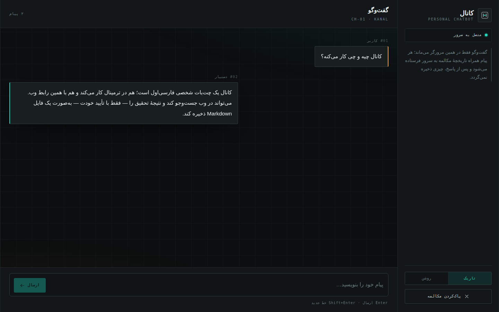
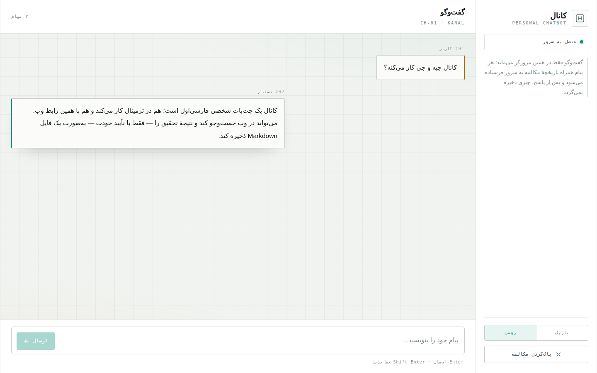
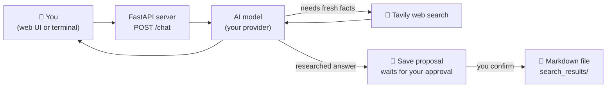

<div align="center">

# کانال · Kanal

### Your personal AI assistant — in Persian first.
### دستیار شخصی هوش مصنوعی تو — به زبان فارسی

**Ask in Persian. Get a researched answer. Save it only when you say so.**
**به فارسی بپرس، جواب تحقیق‌شده بگیر، فقط وقتی خودت گفتی ذخیره‌ش کن.**


> 🚧 **Actively developed** — new features land regularly. See [What's next](#-whats-next--roadmap) below.
>
> 🚧 **در حال توسعهٔ فعال** — قابلیت‌های جدید به‌مرور اضافه می‌شوند. نقشهٔ راه را در [بخش فارسی](#فارسی) ببینید.

**[English](#english) · [فارسی](#فارسی)**

</div>

---

<div align="center">

### See it in action · ببینید چطور کار می‌کند

| Dark theme — a real conversation · تم تیره — یک گفت‌وگوی واقعی | Light theme — the same conversation · تم روشن — همان گفت‌وگو |
|---|---|
|  |  |

</div>

---

<a id="english"></a>

## 🇬🇧 English

Kanal is a **personal AI chatbot that speaks Persian**. It runs on your own machine, talks to you
through a clean chat interface or the terminal, searches the live web when a question needs fresh
information, and turns good research into a saved file — **but only after you explicitly approve it**.

No account. No cloud database. No data leaves your machine except the questions you send to your
own AI provider.

### ✨ What it can do

| Capability | What it means for you |
|---|---|
| **💬 Chat in Persian, right-to-left** | A native-feeling RTL interface with the Vazirmatn font, Persian numerals and dark/light themes. English works too. |
| **🔎 Live web search** | When your question needs up-to-date facts, Kanal searches the web (Tavily) and answers with real sources — not guesses. |
| **💾 Save research — only with your OK** | After a researched answer, Kanal offers to save it as a Markdown file. **Nothing is ever saved automatically**: you review the title, summary and sources first, then press «تأیید و ذخیره». |
| **🖥️ Two ways to talk** | A modern web UI, or a plain terminal chat — same brain, same answers. |
| **🔌 Any OpenAI-compatible provider** | Switch models or providers by changing one setting. You are never locked in. |
| **🔒 Private by design** | Conversations stay in your browser. The server keeps no history and stores no chats. |
| **✅ 293 automated tests** | The backend is covered by 293 tests — including race-condition tests for the save flow — so the safety rules above are verified, not just promised. |

### 🧠 How it works



1. **You ask** — in Persian, from the web UI or the terminal.
2. **Kanal decides** whether the question needs live information. If it does, it searches the web
   (at most 3 searches per message, within a 100-second budget) and keeps the sources.
3. **You get an answer with sources** — and, when the answer is worth keeping, a save proposal:
   title, summary and source list, waiting for your decision.
4. **You approve — or cancel.** Only your click writes the file. Cancelling deletes the proposal
   forever; nothing is saved behind your back.

### 🛠️ Under the hood

| Layer | Technology | Notes |
|---|---|---|
| **Agent** | Python, OpenAI-compatible API | Tool-calling loop with a hard time/tool budget; system prompt locked server-side |
| **Backend** | FastAPI, Uvicorn | `POST /chat` + explicit save confirm/cancel |
| **Frontend** | React 19, TypeScript, Vite 8 | Modular `api / hooks / components / lib` structure, RTL-first CSS |
| **Search** | Tavily | Standard-library-only client, deduplicated queries |
| **Safety** | — | Validated model output, path-traversal-proof file writing, no `eval`/`exec`, no secrets in errors |
| **Tests** | Python `unittest` (293 tests) | Tool calling, save flow, server contract, web search |

> **Why this matters:** most chatbot demos call the model and hope for the best. Kanal treats the
> model's output as *untrusted input*: every argument is validated, every file write is approved by
> a human, and every safety rule has a test proving it.

### 🚀 Run it in 5 minutes

**Requirements:** Python 3.11+, Node.js + npm, and an API key from any OpenAI-compatible provider.
A Tavily key is optional — only needed for web search.

```powershell
# 1. Clone
git clone https://github.com/Alisameni/Kanal.git
cd Kanal

# 2. Python environment
python -m venv .venv
.\.venv\Scripts\Activate.ps1
python -m pip install -r requirements.txt

# 3. Configure (copy .env.example to .env and fill it in)
Copy-Item .env.example .env

# 4. Frontend
npm install
```

| Variable | What it is |
|---|---|
| `API_KEY` | Your AI provider API key |
| `API_BASE_URL` | Your provider's OpenAI-compatible API base URL |
| `MODEL_NAME` | The model to use |
| `SEARCH_API_KEY` | Optional Tavily key for web search |

```powershell
# Terminal chat
python main.py

# Web UI — backend in one terminal, frontend in another
uvicorn server:app --reload --host 127.0.0.1 --port 8000
npm run dev
# then open http://127.0.0.1:5173
```

### 🔌 API

| Method | Endpoint | Purpose |
|---|---|---|
| `GET` | `/` | API status |
| `GET` | `/health` | Health check |
| `POST` | `/chat` | Send a message, get a reply (+ optional save proposal) |
| `POST` | `/save` | Confirm a save proposal — writes the file |
| `POST` | `/save/cancel` | Cancel a save proposal — nothing is written |

### 🧪 Tests & quality

```powershell
python -m unittest discover -v   # backend: 293 tests
npm run lint                      # frontend lint (oxlint)
npm run build                     # frontend production build (tsc + vite)
```

### 🗺️ What's next — roadmap

**Coming soon — in the next versions:**

- [ ] ⚡ **Streaming responses** — answers appear word by word instead of waiting for the whole reply
- [ ] 🧠 **Long-term memory (compaction)** — long conversations keep their context instead of being cut off
- [ ] 💬 **Saved conversations** — your chats survive a page refresh, stored locally in SQLite
- [ ] 🐳 **One-command deploy with Docker** — run the whole stack with a single command

**Exploring for later versions:**

- [ ] 🎙️ **Voice input & spoken answers** — talk to Kanal and hear it reply
- [ ] 📱 **Telegram bot** — chat with Kanal from Telegram, same brain
- [ ] 📎 **Ask about files & links** — send a document or a URL and discuss it
- [ ] 🔐 **Authentication + rate limiting** — ready for a safe public deployment
- [ ] 📰 **Daily research digest** — a morning summary of the topics you follow

---

<a id="فارسی"></a>

## 🇮🇷 فارسی

<div dir="rtl" align="right">

کانال یک **چت‌بات شخصی فارسی‌اول** است. روی کامپیوتر خودت اجرا می‌شود، از طریق یک رابط وب تمیز
یا ترمینال با تو حرف می‌زند، وقتی سؤال به اطلاعات تازه نیاز دارد در وب زنده جست‌وجو می‌کند و تحقیق
خوب را تبدیل به یک فایل ذخیره‌شده می‌کند — **اما فقط وقتی خودت صریحاً تأییدش کنی**.

بدون اکانت. بدون دیتابیس ابری. هیچ داده‌ای از کامپیوتر تو بیرون نمی‌رود، جز سؤال‌هایی که خودت به
پرووایدر هوش مصنوعی‌ات می‌فرستی.

### ✨ قابلیت‌ها

| قابلیت | یعنی چی برای تو؟ |
|---|---|
| **💬 گفت‌وگو به فارسی، راست‌به‌چپ** | رابطی که حس فارسی بودن می‌دهد: فونت وزیرمتن، اعداد فارسی و تم تیره/روشن. انگلیسی هم کار می‌کند. |
| **🔎 جست‌وجوی زنده در وب** | وقتی سؤال به اطلاعات به‌روز نیاز دارد، کانال در وب جست‌وجو می‌کند (Tavily) و با منبع واقعی جواب می‌دهد — نه حدس. |
| **💾 ذخیرهٔ تحقیق — فقط با تأیید تو** | بعد از یک جواب تحقیق‌شده، کانال پیشنهاد می‌دهد آن را به‌صورت فایل Markdown ذخیره کند. **هیچ‌چیز هیچ‌وقت خودکار ذخیره نمی‌شود**: اول عنوان، خلاصه و منابع را می‌بینی، بعد دکمهٔ «تأیید و ذخیره» را می‌زنی. |
| **🖥️ دو راه برای حرف زدن** | رابط وب مدرن یا چت ترمینال — مغز یکی است، جواب‌ها یکی‌اند. |
| **🔌 هر پرووایدر سازگار با OpenAI** | با عوض کردن یک تنظیم، مدل یا پرووایدر را عوض کن. هیچ وابستگی قفلی نیست. |
| **🔒 حریم خصوصی از پایه** | مکالمه‌ها فقط در مرورگر تو می‌مانند. سرور نه تاریخچه نگه می‌دارد، نه چتی ذخیره می‌کند. |
| **✅ ۲۹۳ تست خودکار** | بک‌اند با ۲۹۳ تست پوشش داده شده — از جمله تست race condition برای مسیر ذخیره — پس قوانین امنیتی بالا اثبات‌شده‌اند، نه فقط ادعا. |

### 🧠 چطور کار می‌کند؟

۱. **تو می‌پرسی** — به فارسی، از رابط وب یا ترمینال.
۲. **کانال تصمیم می‌گیرد** سؤال به اطلاعات زنده نیاز دارد یا نه. اگر نیاز داشته باشد، در وب جست‌وجو
می‌کند (حداکثر ۳ جست‌وجو در هر پیام، در سقف زمانی ۱۰۰ ثانیه) و منابع را نگه می‌دارد.
۳. **جواب را با منبع می‌گیری** — و وقتی جواب ارزش نگه داشتن دارد، یک پیشنهاد ذخیره: عنوان، خلاصه و
لیست منابع، در انتظار تصمیم تو.
۴. **تو تأیید می‌کنی — یا لغو می‌کنی.** فقط کلیک تو فایل را می‌نویسد. لغو کردن پیشنهاد را برای
همیشه پاک می‌کند؛ هیچ‌چیز پشت سر تو ذخیره نمی‌شود.

### 🛠️ زیر کاپوت

| لایه | تکنولوژی | توضیح |
|---|---|---|
| **ایجنت** | Python و API سازگار با OpenAI | حلقهٔ فراخوانی Tool با سقف سخت زمانی/تعدادی؛ system prompt سمت سرور قفل است |
| **بک‌اند** | FastAPI و Uvicorn | `POST /chat` + تأیید/لغو صریح ذخیره |
| **فرانت‌اند** | React 19 و TypeScript و Vite 8 | ساختار ماژولار `api / hooks / components / lib` و CSS راست‌به‌چپ‌اول |
| **جست‌وجو** | Tavily | کلاینت فقط با استاندارد لایبرری، بدون جست‌وجوی تکراری |
| **امنیت** | — | اعتبارسنجی خروجی مدل، نوشتن فایل ضد path traversal، بدون `eval`/`exec`، بدون افشای secret در خطاها |
| **تست** | Python `unittest` (۲۹۳ تست) | فراخوانی Toolها، مسیر ذخیره، قرارداد سرور، جست‌وجوی وب |

> **چرا این مهم است؟** بیشتر دموی چت‌بات فقط مدل را صدا می‌زنند و امیدوارند. کانال خروجی مدل را
> **ورودی غیرقابل‌اعتماد** می‌داند: هر آرگومان اعتبارسنجی می‌شود، هر نوشتن فایل را یک انسان تأیید
> می‌کند و هر قانون امنیتی یک تست دارد که آن را اثبات می‌کند.

### 🚀 اجرا در ۵ دقیقه

**نیازمندی‌ها:** Python 3.11 به بالا، Node.js و npm، و یک API key از هر پرووایدر سازگار با OpenAI.
کلید Tavily اختیاری است — فقط برای جست‌وجوی وب لازم است.

```powershell
# 1. کلون
git clone https://github.com/Alisameni/Kanal.git
cd Kanal

# 2. محیط پایتون
python -m venv .venv
.\.venv\Scripts\Activate.ps1
python -m pip install -r requirements.txt

# 3. تنظیمات (فایل .env.example را به .env کپی کن و پرش کن)
Copy-Item .env.example .env

# 4. فرانت‌اند
npm install
```

| متغیر | چیست؟ |
|---|---|
| `API_KEY` | کلید API پرووایدر هوش مصنوعی تو |
| `API_BASE_URL` | آدرس API سازگار با OpenAI پرووایدرت |
| `MODEL_NAME` | مدلی که استفاده می‌شود |
| `SEARCH_API_KEY` | کلید Tavily (اختیاری) برای جست‌وجوی وب |

```powershell
# چت ترمینال
python main.py

# رابط وب — بک‌اند در یک ترمینال، فرانت‌اند در ترمینال دیگر
uvicorn server:app --reload --host 127.0.0.1 --port 8000
npm run dev
# بعد باز کن http://127.0.0.1:5173
```

### 🔌 API

| متد | اندپوینت | کاربرد |
|---|---|---|
| `GET` | `/` | وضعیت API |
| `GET` | `/health` | بررسی سلامت |
| `POST` | `/chat` | ارسال پیام، گرفتن جواب (+ پیشنهاد ذخیره در صورت نیاز) |
| `POST` | `/save` | تأیید پیشنهاد ذخیره — فایل نوشته می‌شود |
| `POST` | `/save/cancel` | لغو پیشنهاد ذخیره — هیچ‌چیز نوشته نمی‌شود |

### 🧪 تست و کیفیت

```powershell
python -m unittest discover -v   # بک‌اند: 293 تست
npm run lint                      # لینت فرانت‌اند (oxlint)
npm run build                     # بیلد نهایی فرانت‌اند (tsc + vite)
```

### 🗺️ نقشهٔ راه — نسخه‌های بعدی

**به‌زودی — در نسخه‌های بعدی:**

- [ ] ⚡ **پاسخ استریمینگ** — جواب کلمه‌به‌کلمه ظاهر می‌شود، بدون انتظار برای کل پاسخ
- [ ] 🧠 **حافظهٔ بلندمدت (Compaction)** — مکالمه‌های طولانی کانتکستشان را از دست نمی‌دهند
- [ ] 💬 **ذخیرهٔ مکالمات** — چت‌هایت با رفرش صفحه پاک نمی‌شوند، لوکال در SQLite ذخیره می‌شوند
- [ ] 🐳 **دیپلوی تک‌دستوری با Docker** — اجرای کل استک با یک دستور

**در دست بررسی برای نسخه‌های بعدتر:**

- [ ] 🎙️ **ورودی صوتی و پاسخ گفتاری** — با کانال حرف بزن و جواب را بشنو
- [ ] 📱 **ربات تلگرام** — از تلگرام با کانال چت کن، با همان مغز
- [ ] 📎 **سؤال دربارهٔ فایل و لینک** — یک سند یا URL بفرست و درباره‌اش بپرس
- [ ] 🔐 **احراز هویت + rate limiting** — آماده برای دیپلوی عمومی امن
- [ ] 📰 **خلاصهٔ تحقیق روزانه** — هر صبح یک خلاصه از موضوع‌هایی که دنبال می‌کنی

</div>

---

## 📄 License · لایسنس

No license has been specified yet. Check the repository for licensing terms before redistributing
the project.
هنوز لایسنسی مشخص نشده است. قبل از بازنشر پروژه، شرایط لایسنس ریپو را بررسی کنید.

---

<div align="center">

**Built by [Ali Sameni](https://github.com/Alisameni) — backend developer learning AI Engineering by building, not just studying.**
**ساختهٔ [علی ثامنی](https://github.com/Alisameni) — برنامه‌نویس بک‌اند، در حال یادگیری AI Engineering با ساختن، نه فقط خواندن.**

*کانال — دستیار شخصی تو، به زبان خودت. · Kanal — your personal assistant, in your own language.*

</div>
